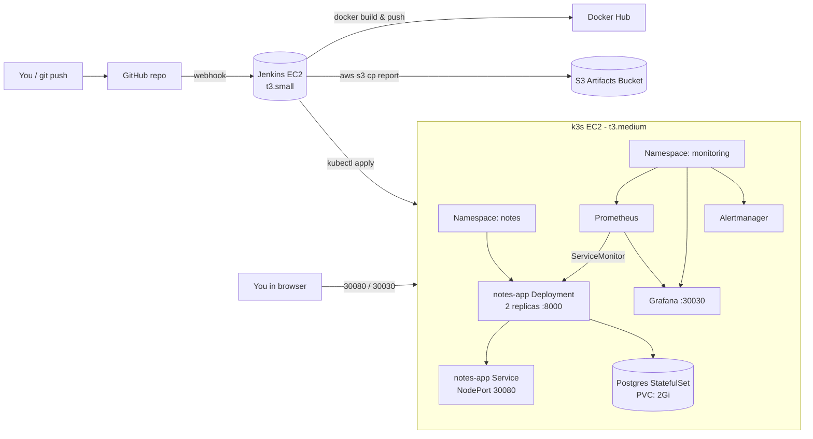

# DevOps Notes App — Hands-on Practice Project

A tiny Python/FastAPI notes app, used as a canvas to practice the full DevOps stack:
**Terraform → Ansible → Docker → Jenkins → Kubernetes (k3s) → Prometheus + Grafana**.

The application is deliberately small. The focus is **infrastructure, automation, and
monitoring**.

> ### Two ways to run this
> - **Free local mode (recommended, $0)** — kind + MinIO + Jenkins in-cluster on your
>   laptop. See [`local/README.md`](local/README.md). One command: `./local/setup-local.sh`.
> - **AWS mode** — real EC2 + S3 + k3s, ~$3-5/day if left on. Everything below applies
>   to this mode.

---

## Folder structure

```
devops-notes-app/
├── terraform/          # AWS infra (VPC, EC2 x2, S3, SGs)
├── ansible/            # Server config (Docker, Jenkins, k3s, Helm, kubectl, SSH)
├── app/                # FastAPI notes app + pytest tests
├── k8s/                # Namespace, ConfigMap, Secret, Postgres, Deployment, Service
├── monitoring/         # Helm values, ServiceMonitor, alerts, Grafana dashboard
├── local/              # Zero-cost local stack (kind + MinIO + Jenkins) + LocalStack
├── Dockerfile          # Image for the notes app
├── docker-compose.yml  # Local dev stack (app + Postgres)
├── Jenkinsfile         # CI/CD pipeline
├── .gitignore
└── README.md
```

---

## Architecture



---

## Costs (warning: NOT fully free-tier)

| Resource | Spec | Monthly if left on 24/7 (us-east-1) |
|---|---|---|
| EC2 jenkins | t3.small (2 vCPU, 2 GiB) | ~$15 |
| EC2 k3s     | t3.medium (2 vCPU, 4 GiB) | ~$30 |
| EBS gp3     | 50 GiB total | ~$4 |
| S3          | <1 GiB | <$1 |
| Data transfer | low | <$1 |

> **t3.medium is NOT free-tier** – only `t3.micro` is. If you want to keep this truly
> free, change `k8s_instance_type = "t3.micro"` in `terraform.tfvars` and skip
> Prometheus/Grafana (it will OOM). Running the project only during practice sessions
> and `terraform destroy` afterwards keeps the cost to a few dollars per month.

---

## Prerequisites on your laptop

```bash
# macOS/Linux
brew install terraform ansible awscli kubectl helm jq
aws configure                    # set your AWS access/secret keys + region
ssh-keygen -t ed25519 -f ~/.ssh/devops-notes   # creates .pub + private key
```

---

## Google OAuth 2.0 login (BYOK)

The app has `/auth/google/login`, `/auth/google/callback`, `/auth/me`, and `/auth/logout`.
`/notes` endpoints are protected — each user sees only their own notes.

### 1) Create the OAuth client (free, in Google Cloud Console)

1. Open **https://console.cloud.google.com/apis/credentials**
2. **CREATE CREDENTIALS → OAuth client ID**
3. Application type: **Web application**
4. **Authorized redirect URIs** — add every URL where you'll run the app:
   - Local kind: `http://localhost:30080/auth/google/callback`
   - AWS EC2 : `http://<K8S_PUBLIC_IP>:30080/auth/google/callback`
   - Any custom domain you attach later: `https://your-domain.com/auth/google/callback`
5. Click **Create** → copy the **Client ID** and **Client Secret**.
6. On the **OAuth consent screen**, add your Google account under **Test users** while
   the app is in Testing mode.

> If you add a custom domain later, you **must** add it to Authorized redirect URIs in
> Google Cloud Console — otherwise OAuth will fail.

### 2) Put the secrets into Kubernetes

Local (kind) — the `local/setup-local.sh` auto-generates `JWT_SECRET` and `SESSION_SECRET`
and reads Google creds from your shell:

```bash
export GOOGLE_CLIENT_ID='...'
export GOOGLE_CLIENT_SECRET='...'
./local/setup-local.sh
```

Already running? Patch and restart:

```bash
kubectl -n notes create secret generic notes-app-secret \
  --from-literal=DB_USER=notes \
  --from-literal=DB_PASSWORD=notes_local_dev \
  --from-literal=GOOGLE_CLIENT_ID=... \
  --from-literal=GOOGLE_CLIENT_SECRET=... \
  --from-literal=JWT_SECRET=$(python3 -c 'import secrets;print(secrets.token_urlsafe(32))') \
  --from-literal=SESSION_SECRET=$(python3 -c 'import secrets;print(secrets.token_urlsafe(32))') \
  --dry-run=client -o yaml | kubectl apply -f -
kubectl -n notes rollout restart deploy/notes-app
```

AWS — edit `k8s/secret.yaml.example` → `secret.yaml` (do NOT commit) and
`k8s/configmap.yaml` so `GOOGLE_REDIRECT_URI` and `APP_BASE_URL` point to
`http://<K8S_PUBLIC_IP>:30080/...`.

### 3) Try it

```bash
curl -I http://localhost:30080/auth/google/login       # expect 302 to accounts.google.com
curl    http://localhost:30080/notes                    # expect 401 (not logged in)
# Open the login URL in a browser:
open    http://localhost:30080/auth/google/login
# After the Google redirect, you'll be bounced back with a `notes_session` cookie.
curl -b "notes_session=..." http://localhost:30080/auth/me
```

### Security notes

- `JWT_SECRET` + `SESSION_SECRET` must be strong random strings. Rotate them if leaked.
- The cookie is `httpOnly`, `SameSite=Lax`. Flip `secure=True` in `app/main.py` once
  you serve the app over HTTPS (behind an ingress / ALB / Cloudflare).
- No OAuth client secret ever lives in Git — only in the Kubernetes Secret / `.env`.

---

## Step-by-step setup

### 1) Fill variables and provision AWS infra

```bash
cd terraform
cp terraform.tfvars.example terraform.tfvars
# edit terraform.tfvars:
#   my_ip_cidr     = "<your public IP>/32"      # curl ifconfig.me
#   ssh_public_key = "<contents of ~/.ssh/devops-notes.pub>"
terraform init
terraform apply                                  # type: yes
terraform output                                 # note the 2 public IPs + S3 bucket name
```

### 2) Configure servers with Ansible

```bash
cd ../ansible
cp inventory.ini.example inventory.ini
# replace JENKINS_PUBLIC_IP and K8S_PUBLIC_IP with the Terraform outputs
ansible all -m ping
ansible-playbook playbook.yml
```

### 3) Grab the Jenkins initial admin password and the kubeconfig

```bash
# Jenkins
ssh -i ~/.ssh/devops-notes ubuntu@<JENKINS_PUBLIC_IP> \
    'sudo cat /var/lib/jenkins/secrets/initialAdminPassword'
# open http://<JENKINS_PUBLIC_IP>:8080 and finish the wizard

# Kubeconfig for your laptop (so you can run kubectl locally)
scp -i ~/.ssh/devops-notes ubuntu@<K8S_PUBLIC_IP>:/home/ubuntu/.kube/config ./kubeconfig
sed -i '' "s/127.0.0.1/<K8S_PUBLIC_IP>/" kubeconfig   # Linux: drop the ''
export KUBECONFIG=$PWD/kubeconfig
kubectl get nodes
```

### 4) Deploy the app manually first (to prove the pipeline target works)

```bash
cd ../k8s
cp secret.yaml.example secret.yaml                 # set a strong DB_PASSWORD
kubectl apply -f namespace.yaml
kubectl apply -f configmap.yaml -n notes
kubectl apply -f secret.yaml    -n notes
kubectl apply -f postgres.yaml  -n notes
# first-time image: just use a public one until Jenkins runs
sed "s|IMAGE_PLACEHOLDER|<YOUR_DOCKERHUB_USER>/notes-app:latest|g" app-deployment.yaml \
  | kubectl apply -n notes -f -
kubectl apply -f app-service.yaml -n notes
kubectl -n notes rollout status deploy/notes-app
curl http://<K8S_PUBLIC_IP>:30080/health          # -> {"status":"ok"}
```

### 5) Install Prometheus + Grafana

```bash
cd ../monitoring
kubectl create namespace monitoring
cp grafana-admin-secret.yaml.example grafana-admin-secret.yaml  # set a password
kubectl apply -f grafana-admin-secret.yaml
helm repo add prometheus-community https://prometheus-community.github.io/helm-charts
helm repo update
helm upgrade --install kps prometheus-community/kube-prometheus-stack \
     -n monitoring -f values.yaml
kubectl apply -f servicemonitor.yaml
kubectl apply -f prometheusrule.yaml
kubectl apply -f grafana-dashboard-configmap.yaml
```

### 6) Open the UIs

| What | URL |
|---|---|
| Notes app | `http://<K8S_PUBLIC_IP>:30080` + `/health`, `/metrics`, `/notes` |
| Prometheus | `http://<K8S_PUBLIC_IP>:30090` |
| Grafana | `http://<K8S_PUBLIC_IP>:30030` (login with the Secret) |

In Grafana, open **Dashboards → Notes App Overview** (auto-provisioned).

### 7) Wire up Jenkins

In Jenkins → **Manage Jenkins → Credentials**, add:

| ID | Type | Value |
|---|---|---|
| `dockerhub-creds` | Username+password | your Docker Hub user + token |
| `aws-creds` | AWS credentials | your AWS access/secret keys |
| `kubeconfig` | Secret file | upload the kubeconfig file you downloaded |
| `s3-artifacts-bucket` | Secret text | bucket name from `terraform output` |

Install plugins: *Pipeline, Git, Docker Pipeline, AWS Steps, JUnit*.

Create a **Multibranch Pipeline** or a **Pipeline from SCM** pointing to this repo.
Edit the top of `Jenkinsfile` to replace `YOUR_DOCKERHUB_USER`. Run the pipeline.

### 8) Destroy everything (very important!)

```bash
# first, remove k8s resources if you still want the artifacts
helm -n monitoring uninstall kps || true
kubectl delete namespace notes monitoring || true

cd terraform
terraform destroy
```

---

## Local development (no AWS)

```bash
cp app/.env.example app/.env
docker compose up --build
curl localhost:8000/health
cd app && PYTHONPATH=.. pytest tests
```

---

## 12 practice exercises (easy → hard)

1. **Easy** – Change `replicas: 2` → `3` in `k8s/app-deployment.yaml`, apply, watch rollout.
2. **Easy** – Add a `/version` endpoint to the app, write a test, open a PR, see Jenkins build.
3. **Easy** – Add a Prometheus counter for note creation (`notes_created_total`), expose it.
4. **Medium** – Add a **new Grafana panel** that charts `rate(notes_created_total[5m])`.
5. **Medium** – Add a **new alert rule**: `HighLatencyP95` – fire when p95 > 500ms for 5m.
6. **Medium** – Switch the app Service from `NodePort` to `ClusterIP` and expose it with a
   k3s `Ingress`.
7. **Medium** – Add Horizontal Pod Autoscaler on CPU; load-test with `hey` and watch it scale.
8. **Hard** – Add a second Ansible role to install `fail2ban` and ship its logs to a file
   Prometheus can read via `node_exporter --collector.textfile.directory`.
9. **Hard** – **Break the app on purpose**: `kubectl -n notes scale deploy notes-app --replicas=0`.
   Watch `AppDown` fire. Then set a bad `IMAGE_PLACEHOLDER` tag and watch `CrashLoopBackOff` +
   see the alert. Then flood `/notes` POSTs that 500 (point `DB_HOST` to a wrong value) and
   watch `HighErrorRate` fire.
10. **Hard** – Add a nightly `CronJob` that `pg_dump`s Postgres and `aws s3 cp`s it to S3.
11. **Hard** – Split Terraform into `modules/vpc`, `modules/compute`, `modules/s3` and use
    them from `terraform/main.tf`.
12. **Hard** – Replace the single-node k3s with **k3s HA** (3 server nodes) via Terraform
    and update Ansible to configure the join tokens.

---

## Troubleshooting

| Symptom | Likely cause / fix |
|---|---|
| `terraform apply` fails on AMI | Pin a current Ubuntu 22.04 AMI for your region: `aws ec2 describe-images --owners 099720109477 --filters 'Name=name,Values=ubuntu/images/hvm-ssd/ubuntu-jammy-22.04-amd64-server-*' --query 'Images|sort_by(@,&CreationDate)[-1].ImageId'` |
| Ansible `UNREACHABLE` | Check the SG allows your IP; check `ansible_user=ubuntu`; private key perms must be `600`. |
| `kubectl` says `localhost:8080 refused` | You forgot `export KUBECONFIG=...` or didn't replace `127.0.0.1` with the public IP in the kubeconfig. |
| Pods stay `Pending` | `kubectl describe pod ...` – usually not enough memory on `t3.medium`; try smaller `resources.requests`. |
| ServiceMonitor not scraped | Label `release: kps` on the SM **and** service port named `http`. Check **Prometheus → Status → Targets**. |
| Grafana shows "no data" | Open **Explore** and run `up{job="notes-app"}` – if empty, SM selector doesn't match the service labels. |
| Jenkins can't `kubectl` | `kubeconfig` credential file wasn't uploaded, or the k3s SG doesn't allow 6443 from the Jenkins SG. |
| Docker push fails | Create a Docker Hub access token and store it in `dockerhub-creds`. |
| `terraform destroy` fails on S3 | S3 bucket not empty: it has `force_destroy = true`, but if versioning left markers, empty manually: `aws s3 rm s3://<bucket> --recursive`. |

---

## Security rules this project follows

- No passwords, keys or tokens in code – all come from `.env`, Jenkins credentials, or
  Kubernetes Secrets (`notes-app-secret`, `grafana-admin`).
- SSH is restricted to **your IP only** (`my_ip_cidr`).
- Only ports **22, 8080, 30030, 30080, 30090** and k3s `6443` (SG-to-SG) are open.
- S3 bucket blocks all public access and has versioning enabled.
- `.gitignore` excludes `.env`, `*.tfstate`, `*.tfvars`, `*.pem`.

Happy breaking (and fixing) things!
